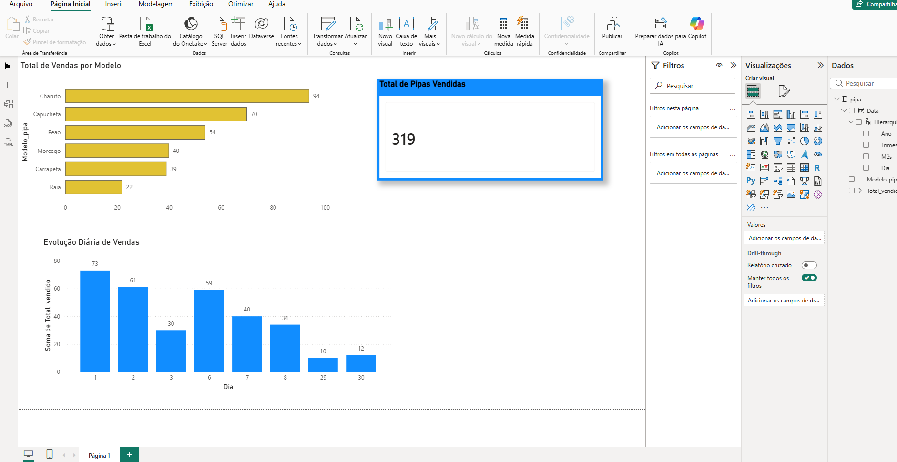

# 🪁 Dashboard Executivo de Vendas (SQL + Power BI)

Fala, pessoal! 👋 Este é um projeto pessoal de análise de dados desenvolvido ao longo de 3 dias intensos de trabalho, focado em transformar registros brutos num painel executivo dinâmico e interativo.

---

## 📸 Visualização do Dashboard

---

## 🎯 O Desafio
O objetivo foi estruturar o fluxo completo de dados para uma operação de vendas de pipas:
1. Modelar o banco de dados e garantir a integridade dos dados registados.
2. Criar consultas SQL limpas e otimizadas para validação dos números.
3. Construir um dashboard no Power BI com foco na experiência do utilizador (UX/UI) e suporte à tomada de decisão.

---

## 🛠️ O que foi utilizado
* **PL/SQL:** Estruturação das tabelas (`Pipa` e `Saidas`) e queries de validação de totais.
* **Power BI Desktop:** Modelagem de dados, métricas, design do relatório e criação de KPIs dinâmicos.
* **IA como Co-piloto:** Utilização pontual de Inteligência Artificial para validação de boas práticas de negócio, revisão de lógica e otimização do fluxo visual.

---

## 💡 Principais Resultados & Insights
* **Volume Total:** 319 vendas registadas e consolidadas no período.
* **Campeão de Vendas:** O modelo **Charuto** liderou a procura com **94 unidades**.
* **Visão Temporal:** Identificação clara dos picos e vales de vendas ao longo dos dias do mês.

---

## 📂 Arquivos no Repositório
* `power.pbix`: Arquivo editável do Power BI (podes baixar e interagir!).
* `Projeto_pipas.txt`: Scripts em SQL com a criação de tabelas e consultas.
* `power.png`: Imagem para visualização rápida do painel.

---
🚀 *Projeto desenvolvido por Lucas Matheus.*
